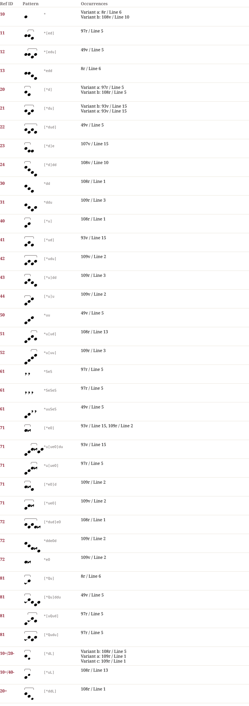

# Aa 13 — Notationsdokumentation
**Aa 13**

## Muster & Entsprechungen (37)

## Zeilengalerie (13)

*The manuscript lines are not part of the dataset (the rights of the library images are unclear). The HTML page `Aa_13.notation.html` shows them from the IIIF server of the library where the page could be determined.*

