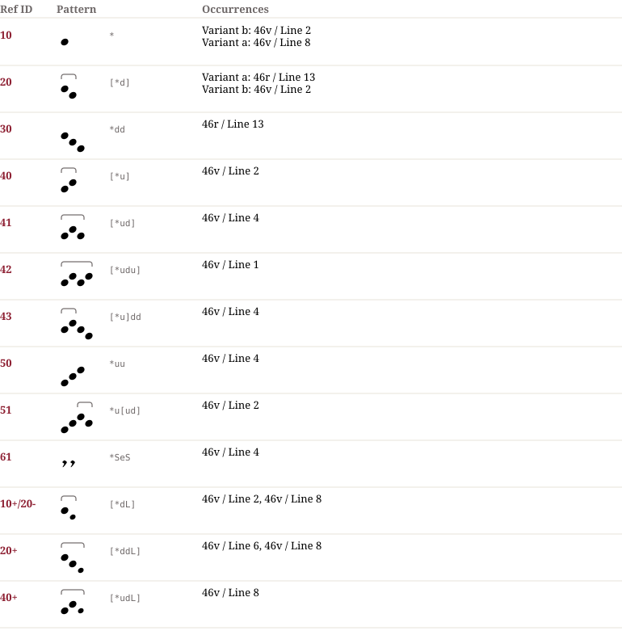

# Ba 12 — Notationsdokumentation
**Ba 12**

## Muster & Entsprechungen (13)

## Zeilengalerie (6)

*The manuscript lines are not part of the dataset (the rights of the library images are unclear). The HTML page `Ba_12.notation.html` shows them from the IIIF server of the library where the page could be determined.*
