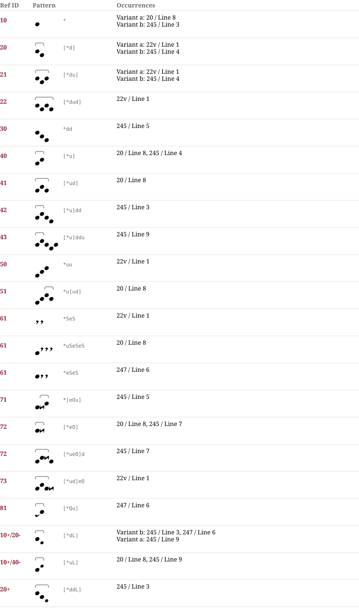

# Be 40078 — Notationsdokumentation
**Be 40078**

## Muster & Entsprechungen (22)

## Zeilengalerie (8)

*The manuscript lines are not part of the dataset (the rights of the library images are unclear). The HTML page `Be_40078.notation.html` shows them from the IIIF server of the library where the page could be determined.*

