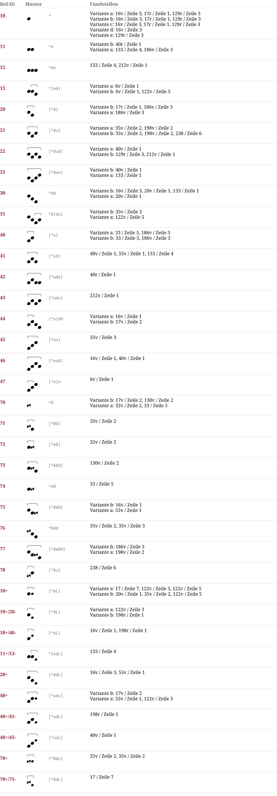

# Ben 34 — Notationsdokumentation
**Ben 34**

Das erste Zeichen einer Gruppe gibt in vielen Fällen die melodische Richtung gegenüber dem vorangehenden Ton an.
10: 10a nach vorangehendem tieferen Ton, 10b nach vorangehendem höheren Ton, 10c nach vorangehendem gleichen oder tieferen Ton, 10d nach vorangehendem tieferen Ton, 10e richtungsunabhängig für leichte Töne.
11: 11a nach vorangehendem tieferen Ton, 11b nach vorangehendem gleichen oder höheren Ton.
13: 13a nach vorangehendem tieferen Ton, 13b nach vorangehendem tieferen Ton.
20: 20a nach vorangehendem tieferen Ton, 20b nach vorangehendem gleichen oder höheren Ton.
21: 21a nach vorangehendem tieferen Ton, 21b nach vorangehendem gleichen oder höheren Ton.
22: 22a nach vorangehendem tieferen Ton, 22b nach vorangehendem gleichen oder höheren Ton.
23: 23a nach vorangehendem tieferen Ton, 23b nach vorangehendem gleichen oder höheren Ton.
30: 30a nach vorangehendem tieferen Ton, 30b nach vorangehendem höheren Ton (das erste Zeichenelement sieht aus wie ein Oriscus, die Verwendung in genau dieser Position spricht aber gegen eine Auffassung als Oriscus).
31: 31a nach vorangehendem tieferen Ton, 31b nach vorangehendem höheren Ton (wie 30b).
40: 40a ohne Einschränkungen, 40b genaue Bedeutung unbekannt, steht meist vor folgendem höheren Ton.
70: 70a meist in typischen Oriscus-Positionen (nach gleichem und vor tieferem Ton), 70b nur im Aufstieg (nach tieferem, vor höherem Ton), die Position scheint dem mittleren Element des sanktgaller Salicus zu entsprechen.
75: 75a nach vorangehendem tieferen Ton, 75b nach vorangehendem gleichen oder höheren Ton.
77: 77a nach vorangehendem tieferen Ton, 77b nach vorangehendem gleichen oder höheren Ton.
10+: 10+a nach tieferen, vor gleichem oder tieferem Ton, 10+b in den übrigen Positionen; die Differenzierung zwischen schwächeren und stärkeren Liqueszenzen ist in der Nummerierung nicht berücksichtigt.
10+/20-: wie 10+.
40+: wie 40.

## Muster & Entsprechungen (37)

## Zeilengalerie (25)

*The manuscript lines are not part of the dataset (the rights of the library images are unclear). The HTML page `Ben_34.notation.html` shows them from the IIIF server of the library where the page could be determined.*

