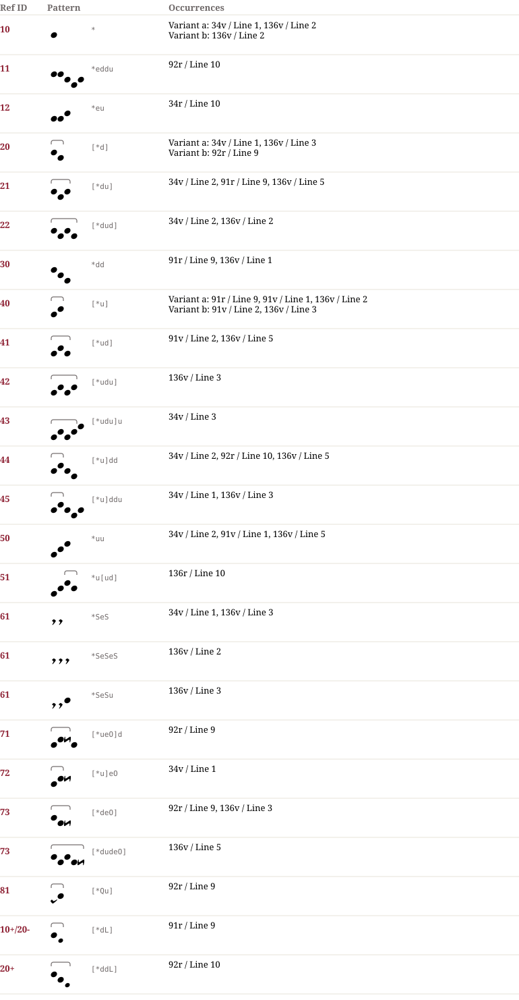

# Ful 62 — Notationsdokumentation
**Ful 62**

Notator A: f. 91–92v, f. 92, f. 10, f. 34 –34v.
Notator B: f. 136 –136v.

## Muster & Entsprechungen (25)

## Zeilengalerie (14)

*The manuscript lines are not part of the dataset (the rights of the library images are unclear). The HTML page `Ful_62.notation.html` shows them from the IIIF server of the library where the page could be determined.*

