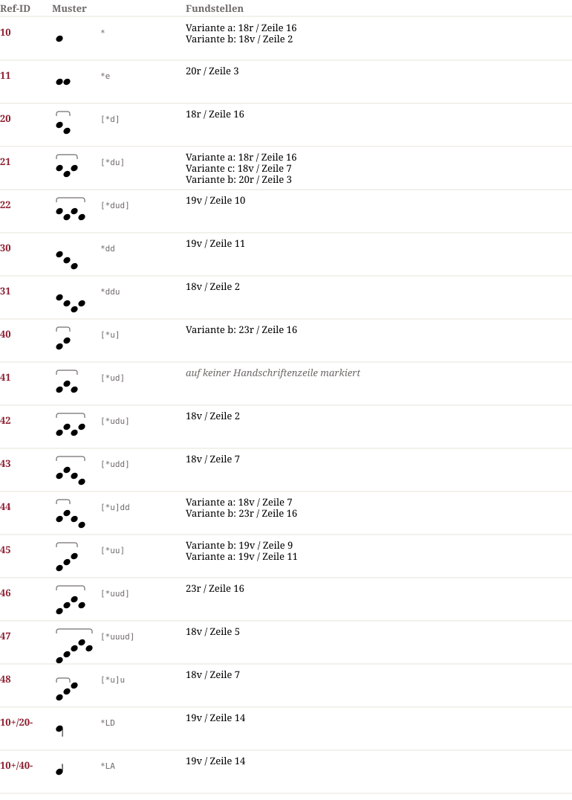

# Ox 340 — Notationsdokumentation
**Ox 340**

## Muster & Entsprechungen (18)

## Zeilengalerie (10)

*The manuscript lines are not part of the dataset (the rights of the library images are unclear). The HTML page `Ox_340.notation.html` shows them from the IIIF server of the library where the page could be determined.*

