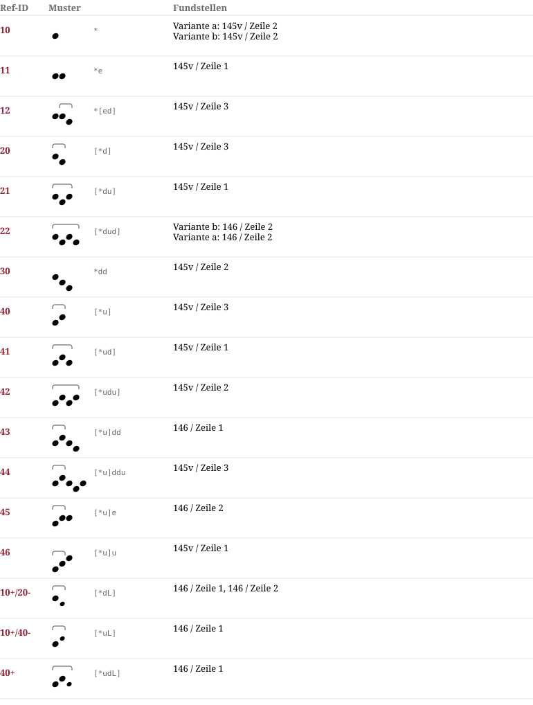

# Pa 1107 — Notationsdokumentation
**Pa 1107**

## Muster & Entsprechungen (17)

## Zeilengalerie (5)

*The manuscript lines are not part of the dataset (the rights of the library images are unclear). The HTML page `Pa_1107.notation.html` shows them from the IIIF server of the library where the page could be determined.*

