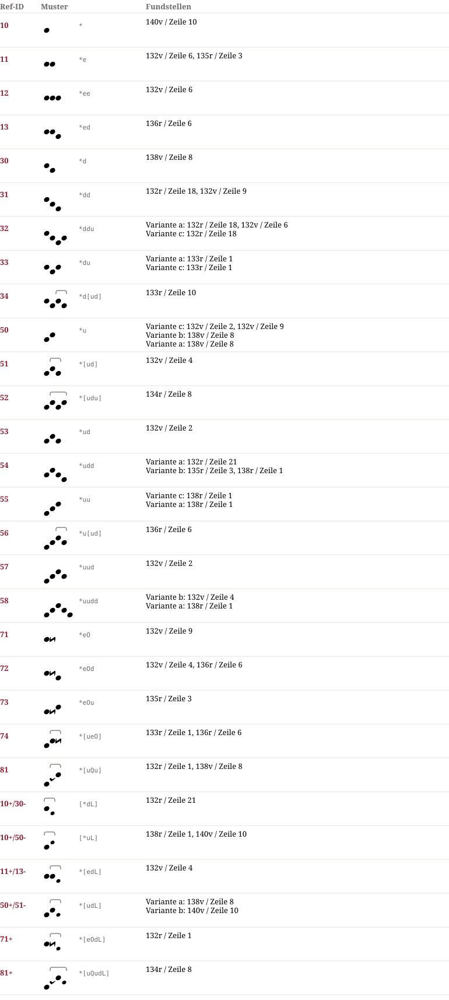

# Pa 1118 — Notationsdokumentation

**Pa 1118**

## Muster & Entsprechungen (29)

## Zeilengalerie (15)

*The manuscript lines are not part of the dataset (the rights of the library images are unclear). The HTML page `Pa_1118.notation.html` shows them from the IIIF server of the library where the page could be determined.*

