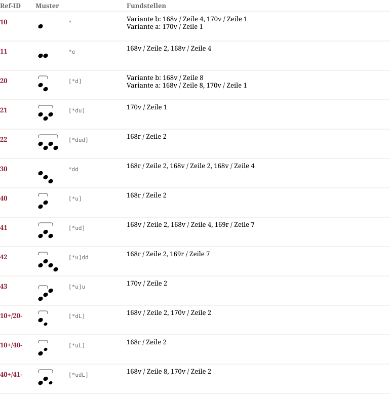

# Pa 17328 — Notationsdokumentation

**Pa 17328**

20b nach Tonwiederholung innerhalb derselben Silbe.

## Muster & Entsprechungen (13)

## Zeilengalerie (7)

*The manuscript lines are not part of the dataset (the rights of the library images are unclear). The HTML page `Pa_17328.notation.html` shows them from the IIIF server of the library where the page could be determined.*

