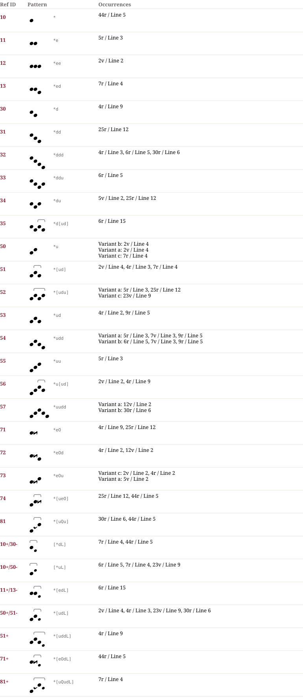

# Pa 1871 — Notationsdokumentation

**Pa 1871**

## Muster & Entsprechungen (30)

## Zeilengalerie (17)

*The manuscript lines are not part of the dataset (the rights of the library images are unclear). The HTML page `Pa_1871.notation.html` shows them from the IIIF server of the library where the page could be determined.*

