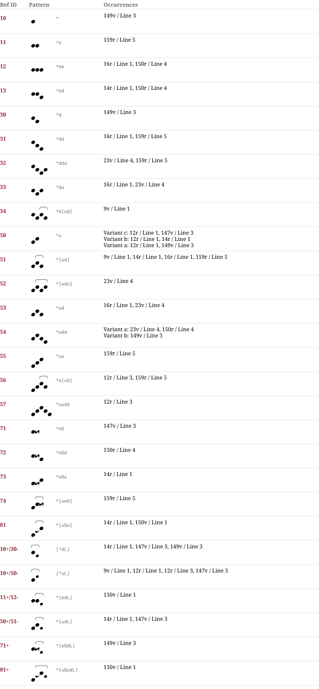

# Pa 903 — Notationsdokumentation

**Pa 903**

50: In Pa 903 werden die auch sonst bekannten graphischen Varianten mit diastematischer Bedeutung verwendet: 50b nur bei Halbtonschritten, 50c nur, wenn die 2. Note einen Halbtonschritt über sich hat.
81: In Pa 903 wird das Quilismazeichen nur bei Halbtonschritt zwischen der 2. und 3. Note verwendet.

## Muster & Entsprechungen (28)

## Zeilengalerie (11)

*The manuscript lines are not part of the dataset (the rights of the library images are unclear). The HTML page `Pa_903.notation.html` shows them from the IIIF server of the library where the page could be determined.*

