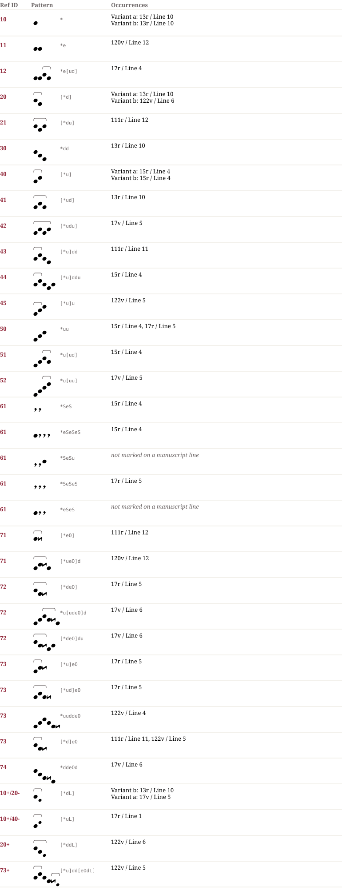

# Wü 165 — Notationsdokumentation
**Wü 165**

## Muster & Entsprechungen (34)

## Zeilengalerie (13)

*The manuscript lines are not part of the dataset (the rights of the library images are unclear). The HTML page `Wü_165.notation.html` shows them from the IIIF server of the library where the page could be determined.*

